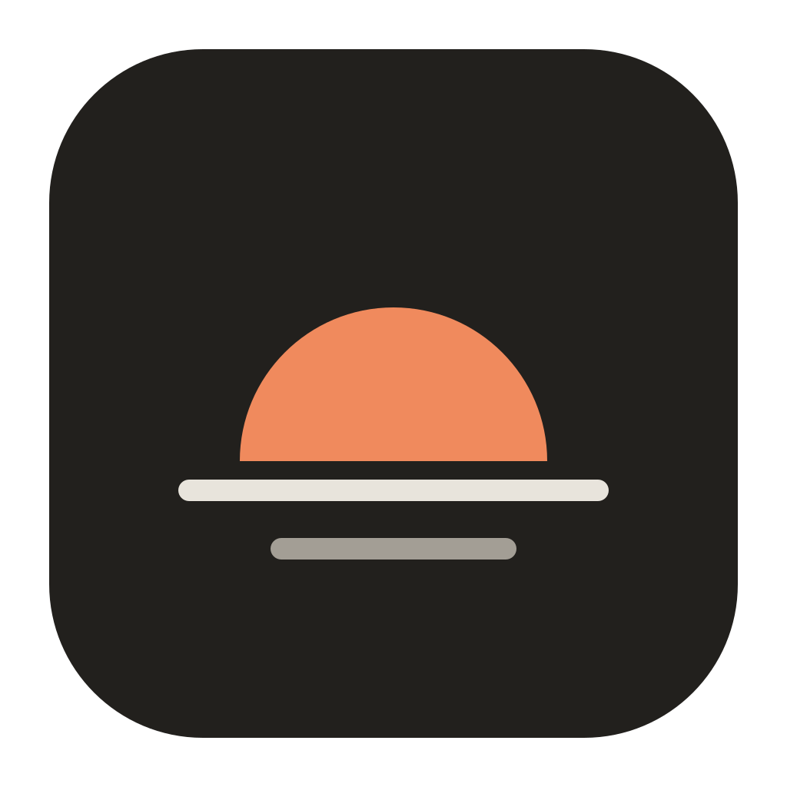
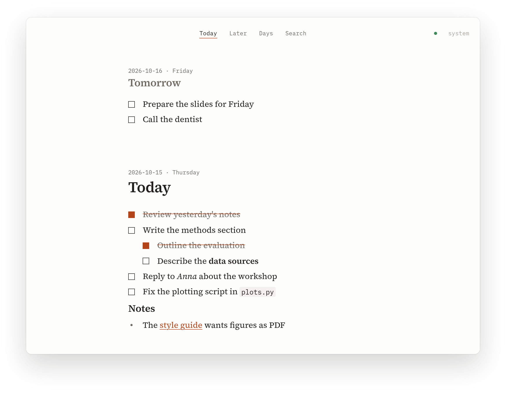

<p align="center">
  
</p>

<h1 align="center">Orthros</h1>

<p align="center">A quiet daily todo journal for macOS and Linux.</p>

<p align="center">
  <a href="https://github.com/FreaxMATE/orthros/actions/workflows/ci.yml"></a>
  <a href="https://github.com/FreaxMATE/orthros/releases/latest"></a>
  <a href="LICENSE"></a>
</p>

<p align="center">
  <a href="https://freaxmate.github.io/orthros/">Website</a> ·
  <a href="https://github.com/FreaxMATE/orthros/releases/latest">Download</a>
</p>

<picture>
  <source media="(prefers-color-scheme: dark)" srcset="site/screenshot-dark.png">
  
</picture>

Write down the few things that matter today. Park everything else in **Later**.
Your days are plain markdown files on your computer, optionally synced with a
server you run yourself.

## Install

Download Orthros from the **[latest release](https://github.com/FreaxMATE/orthros/releases/latest)** and open it. That's all: it works on its own, no account, no server.

| System | File |
|---|---|
| macOS (Apple silicon / Intel) | `Orthros_*_aarch64.dmg` / `Orthros_*_x64.dmg` |
| Any Linux | `Orthros_*.AppImage` or `Orthros_*.flatpak` |
| Debian, Ubuntu | `Orthros_*.deb` |
| Fedora, openSUSE | `Orthros-*.rpm` |
| Nix, NixOS | `nix run github:FreaxMATE/orthros` ([more](#nix-and-nixos)) |
| Android (arm64) | `Orthros_*_arm64.apk` ([more](#android)) |

<details>
<summary>macOS says the app can't be opened</summary>

Orthros isn't signed with an Apple developer certificate. After moving it to Applications, run once in Terminal:

```sh
xattr -dr com.apple.quarantine /Applications/Orthros.app
```
</details>

## Features

- **One column of days.** Tomorrow, today and the days before, so you can plan the evening before.
- **Later.** A separate list for ideas and someday tasks, out of today's way.
- **Notes.** Trip ideas, life goals, books to read: a short list of notes next to Later. Pin the ones you want on top.
- **Map.** Every Google Maps or OpenStreetMap link in your notes becomes a pin: blue while planned, green once you tick the line. Countries you've been to are shaded; click a country to add it. Works offline with country outlines; streets and satellite when online.
- **Link cards.** A line that is only a link shows the page's title, image and description. Fetched once, kept for offline.
- **Markdown that stays out of the way.** Checkboxes, nesting, headings, bold, code and links; the syntax only shows on the line you're editing.
- **Tables and code.** Markdown tables show as a clean grid; Tab moves between cells and the columns line up by themselves. Fenced code blocks are highlighted for over 140 languages, with a copy button.
- **LaTeX math.** `$\alpha^2$` inside a sentence, `$$...$$` for an equation of its own, typeset with KaTeX. Click a formula to edit its source. Math pasted from ChatGPT (`\(...\)`, `\[...\]`) works too.
- **Quick capture.** A shortcut from anywhere opens a small popup: type, Enter, done.
- **Plain files.** Every day is a `.md` file you can grep, back up or open in any editor.
- **Sync, if you want it.** Offline-first, with your own server. Edits from several devices merge line by line.

## Quick capture

- **macOS:** press `Ctrl-Option-Space` while Orthros is running.
- **Linux:** add a keyboard shortcut in your desktop's settings that runs `orthros --capture` (Flatpak: `flatpak run io.github.freaxmate.orthros --capture`).

Closing the window keeps Orthros running in the menu bar or top bar. On GNOME, the icon needs the [AppIndicator extension](https://extensions.gnome.org/extension/615/appindicator-support/).

## Sync your devices

Optional. You need a machine that's always on, such as a home server, a Raspberry Pi or a small VPS.

**1. Start the server**, with one of these. It prints a token on first start.

```sh
# Docker or Podman
docker run -d --name orthros --restart unless-stopped -p 127.0.0.1:8787:8787 -v orthros:/data ghcr.io/freaxmate/orthros-server

# Or any Linux with systemd
curl -fsSL https://freaxmate.github.io/orthros/install-server.sh | sh
```

On NixOS: `services.orthros-server.enable = true;` ([below](#nix-and-nixos)). Binaries for other setups are on the [release page](https://github.com/FreaxMATE/orthros/releases/latest). Show the token again with `docker exec orthros /orthros-server token` or `sudo cat /var/lib/orthros/token`.

**2. Make it reachable over HTTPS.** The easiest way is [Tailscale](https://tailscale.com), which keeps it private to your devices:

```sh
sudo tailscale serve --bg --https=8444 http://127.0.0.1:8787
```

Any reverse proxy with HTTPS (Caddy, nginx) works too.

**3. Connect each device:**

```sh
orthros --connect https://your-server:8444 YOUR-TOKEN
```

On macOS, run `/Applications/Orthros.app/Contents/MacOS/orthros --connect …`; with Flatpak, `flatpak run io.github.freaxmate.orthros --connect …`.
Update the server and every device together: an older version does not know notes and stops syncing when it meets one.
The dot at the top right of the window shows the state: green when synced, amber when the server can't be reached. Changes made meanwhile are kept and sent later.

## Android

Install `Orthros_*_arm64.apk` from the release (with [Obtainium](https://obtainium.imranr.dev) it stays up to date). Your notes live inside the app on the phone; connect it to your sync server to share them with your computers:

1. On the computer, click the sync dot at the top right, then **Connect a phone**.
2. On the phone, tap the sync dot, then **Scan to connect**, and point it at the QR code.

The phone needs to reach the server over HTTPS, e.g. with the Tailscale app.

## Nix and NixOS

```nix
# flake.nix
inputs.orthros.url = "github:FreaxMATE/orthros";
```

The app, with Home Manager (it also sets up sync and a GNOME shortcut, `Ctrl+Alt+Space`):

```nix
imports = [ inputs.orthros.homeManagerModules.default ];
programs.orthros = {
  enable = true;
  sync.server = "https://your-server:8444";   # optional; token in ~/.config/orthros/token
};
```

The server, on NixOS:

```nix
imports = [ inputs.orthros.nixosModules.server ];
services.orthros-server.enable = true;   # 127.0.0.1:8787, token in /var/lib/orthros/token
```

## Keys

| Key | Action |
|---|---|
| `Enter` / `Tab` / `Shift-Tab` | new task (in a day, after any line), indent, outdent |
| `Ctrl-Enter` | tick or untick; makes a line a task |
| `[] ` at the start of a line | becomes a task |
| `Shift-Enter` | a new line without a checkbox; under a task it belongs to the task (a note, a table, code) |
| `Backspace` on a new empty task | makes it a plain line |
| ```` ``` ```` or `\|` on a new empty item | starts a code block or table under the item above |
| `Alt-Up` / `Alt-Down` | move an item (with its sub-items); past the first or last item, into the next day |
| drag the ⋮⋮ grip (shows on hover) | move an item to another place, another day, or onto the Notes tab (it lands in Later) |
| `Ctrl-1` … `Ctrl-5` | Today, Notes, Map, Days, Search |
| `Ctrl-K` | search |

On macOS, `Cmd` instead of `Ctrl`.

## Build from source

```sh
nix develop            # or: Rust, Node and the Tauri prerequisites
npm install
npm run tauri dev
cargo test --workspace
```

The Android APK is built by [android.yml](.github/workflows/android.yml) (Actions tab, **Run workflow**, or any release tag). To sign it with your own key, create one once and store it as repository secrets `ANDROID_KEYSTORE` (base64 of the file), `ANDROID_KEYSTORE_PASSWORD` and `ANDROID_KEY_ALIAS`:

```sh
nix shell nixpkgs#jdk -c keytool -genkeypair -keystore orthros.jks -alias orthros -keyalg RSA -keysize 4096 -validity 10000
base64 -w0 orthros.jks   # the value for ANDROID_KEYSTORE; keep orthros.jks somewhere safe
```

Built with [Tauri](https://tauri.app), Rust and [CodeMirror](https://codemirror.net).

## Map data

Country borders: [Natural Earth](https://www.naturalearthdata.com) (public domain), shipped with the app. Streets: [OpenFreeMap](https://openfreemap.org), © OpenMapTiles, data from [OpenStreetMap](https://www.openstreetmap.org/copyright). Satellite: Esri World Imagery (online only). Place names in short links are looked up with [Nominatim](https://nominatim.org). Map tiles and places you've looked at are cached in `.cache/` in your data folder, which is never synced.

## License

[AGPL-3.0](LICENSE)
